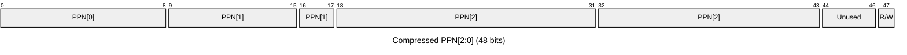
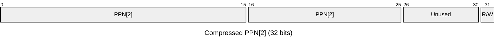

# Design document: a compressed memory-access trace format for a RISC-V emulator
**Nick Chaiyachakorn – 2026-10-14**

## The Problem
**Context**: I am implementing a RISC-V (64-bit) emulator, with an Sv39x4 paging scheme. One feature of this emulator is "meta-paging": not all emulated physical memory is resident in the emulator, but is split into "meta-pages" that are "meta-paged" to and from a larger backing store on disk.

Now let's say we have a resident memory budget -- say, 8MB. We need to determine, in an evidence-driven way:

- The size of each metapage, assuming an integer multiple of base 4 KiB pages;
- The number of metapages resident in memory.
I want to answer this question by simulating the costs of each scheme using ***recorded physical simulated memory access traces. ***(i.e. recordings of memory addresses accessed using a real workload!)

**The problem we'll solve here: **what is a good compressed format to store simulated memory access traces?

Let's now specify goals, non-goals, and hint at design choices:

## Goals and Non-Goals
**Non-goals:**

- **No full address precision needed**
  - This allows us to store only a subset of the bits of an accessed address.
- **No need for a constant address precision over time**
  - This allows us to switch between "bursts" of high-precision address traces, sandwiched between longer spans of lower-precision address traces.
**Goals:**

- **Duration: **Our traces should allow us to record access patterns over enough time for an emulated minimal Linux to boot to a shell -- say, ~100 seconds.
- **Small-ish memory trace recordings**: The above recorded ~100-second trace should not exceed, say, 128MB!

## Proposed Solution
**The key idea: **alternate between short "high-fidelity" bursts, sandwiched with long spans of "low-fidelity" recordings. These have different sampling rates, and compressed address storage formats.

<svg xmlns="http://www.w3.org/2000/svg" viewBox="0 0 1428 458" role="img" aria-labelledby="diagramTitle diagramDesc"> <title id="diagramTitle">High-fidelity bursts and low-fidelity spans over time</title> <desc id="diagramDesc">Three short high-fidelity bursts alternate with three longer low-fidelity spans. The first burst is labeled as having compressed 48-bit addresses, and the first span as having compressed 32-bit addresses. Time increases to the right.</desc> <defs><marker id="arrowhead" markerWidth="11" markerHeight="9" refX="9" refY="4.5" orient="auto" markerUnits="strokeWidth"><path d="M0 0 L10 4.5 L0 9 Z" fill="#000"/></marker></defs> <g font-family="Arial, Helvetica, sans-serif" fill="#000"> <rect x="55" y="270" width="125" height="54" fill="#000"/> <ellipse cx="73" cy="301" rx="16" ry="31" fill="#000"/> <ellipse cx="102" cy="301" rx="16" ry="31" fill="#000"/> <ellipse cx="131" cy="301" rx="16" ry="31" fill="#000"/> <ellipse cx="160" cy="301" rx="16" ry="31" fill="#000"/> <path d="M181.00,273.00 L181.50,273.62 L182.00,275.43 L182.50,278.38 L183.01,282.31 L183.51,287.07 L184.01,292.44 L184.51,298.19 L185.01,304.06 L185.51,309.80 L186.01,315.14 L186.52,319.87 L187.02,323.77 L187.52,326.67 L188.02,328.44 L188.52,329.00 L189.02,328.33 L189.52,326.46 L190.03,323.47 L190.53,319.50 L191.03,314.71 L191.53,309.32 L192.03,303.56 L192.53,297.69 L193.03,291.97 L193.54,286.64 L194.04,281.94 L194.54,278.08 L195.04,275.23 L195.54,273.51 L196.04,273.00 L196.54,273.72 L197.05,275.64 L197.55,278.68 L198.05,282.69 L198.55,287.51 L199.05,292.92 L199.55,298.69 L200.05,304.56 L200.56,310.27 L201.06,315.58 L201.56,320.24 L202.06,324.06 L202.56,326.86 L203.06,328.53 L203.56,328.99 L204.07,328.22 L204.57,326.25 L205.07,323.17 L205.57,319.12 L206.07,314.27 L206.57,308.84 L207.07,303.06 L207.58,297.19 L208.08,291.49 L208.58,286.21 L209.08,281.58 L209.58,277.80 L210.08,275.04 L210.58,273.42 L211.09,273.02 L211.59,273.84 L212.09,275.86 L212.59,278.98 L213.09,283.07 L213.59,287.95 L214.09,293.41 L214.60,299.19 L215.10,305.06 L215.60,310.74 L216.10,316.00 L216.60,320.60 L217.10,324.34 L217.60,327.05 L218.11,328.62 L218.61,328.97 L219.11,328.10 L219.61,326.03 L220.11,322.86 L220.61,318.73 L221.11,313.82 L221.62,308.35 L222.12,302.56 L222.62,296.69 L223.12,291.02 L223.62,285.79 L224.12,281.22 L224.62,277.52 L225.13,274.86 L225.63,273.34 L226.13,273.04 L226.63,273.97 L227.13,276.09 L227.63,279.30 L228.13,283.46 L228.64,288.40 L229.14,293.89 L229.64,299.69 L230.14,305.55 L230.64,311.21 L231.14,316.43 L231.64,320.96 L232.15,324.61 L232.65,327.23 L233.15,328.70 L233.65,328.94 L234.15,327.96 L234.65,325.80 L235.15,322.54 L235.66,318.34 L236.16,313.37 L236.66,307.87 L237.16,302.06 L237.66,296.20 L238.16,290.55 L238.66,285.37 L239.17,280.87 L239.67,277.25 L240.17,274.68 L240.67,273.27 L241.17,273.07 L241.67,274.10 L242.17,276.32 L242.68,279.62 L243.18,283.86 L243.68,288.85 L244.18,294.38 L244.68,300.20 L245.18,306.05 L245.68,311.68 L246.19,316.84 L246.69,321.31 L247.19,324.88 L247.69,327.40 L248.19,328.77 L248.69,328.91 L249.19,327.82 L249.70,325.56 L250.20,322.22 L250.70,317.94 L251.20,312.92 L251.70,307.38 L252.20,301.55 L252.70,295.70 L253.21,290.09 L253.71,284.95 L254.21,280.52 L254.71,276.99 L255.21,274.51 L255.71,273.20 L256.21,273.11 L256.72,274.25 L257.22,276.56 L257.72,279.95 L258.22,284.26 L258.72,289.31 L259.22,294.87 L259.72,300.70 L260.23,306.54 L260.73,312.14 L261.23,317.25 L261.73,321.65 L262.23,325.14 L262.73,327.57 L263.23,328.83 L263.74,328.86 L264.24,327.68 L264.74,325.32 L265.24,321.89 L265.74,317.54 L266.24,312.47 L266.74,306.89 L267.25,301.05 L267.75,295.21 L268.25,289.63 L268.75,284.54 L269.25,280.18 L269.75,276.73 L270.25,274.35 L270.76,273.15 L271.26,273.16 L271.76,274.40 L272.26,276.81 L272.76,280.28 L273.26,284.66 L273.76,289.76 L274.27,295.36 L274.77,301.20 L275.27,307.03 L275.77,312.60 L276.27,317.66 L276.77,321.99 L277.27,325.39 L277.78,327.72 L278.28,328.88 L278.78,328.81 L279.28,327.52 L279.78,325.06 L280.28,321.55 L280.78,317.13 L281.29,312.00 L281.79,306.39 L282.29,300.55 L282.79,294.72 L283.29,289.17 L283.79,284.14 L284.29,279.85 L284.80,276.49 L285.30,274.20 L285.80,273.10 L286.30,273.22 L286.80,274.56 L287.30,277.07 L287.80,280.62 L288.31,285.08 L288.81,290.23 L289.31,295.85 L289.81,301.70 L290.31,307.52 L290.81,313.06 L291.31,318.06 L291.82,322.32 L292.32,325.63 L292.82,327.87 L293.32,328.92 L293.82,328.75 L294.32,327.35 L294.82,324.80 L295.33,321.20 L295.83,316.72 L296.33,311.54 L296.83,305.90 L297.33,300.05 L297.83,294.23 L298.33,288.72 L298.84,283.74 L299.34,279.52 L299.84,276.25 L300.34,274.06 L300.84,273.06 L301.34,273.29 L301.84,274.73 L302.35,277.33 L302.85,280.97 L303.35,285.49 L303.85,290.69 L304.35,296.35 L304.85,302.21 L305.35,308.01 L305.86,313.51 L306.36,318.46 L306.86,322.64 L307.36,325.87 L307.86,328.00 L308.36,328.95 L308.86,328.67 L309.37,327.18 L309.87,324.53 L310.37,320.85 L310.87,316.30 L311.37,311.07 L311.87,305.40 L312.37,299.54 L312.88,293.74 L313.38,288.27 L313.88,283.35 L314.38,279.20 L314.88,276.02 L315.38,273.93 L315.88,273.03 L316.39,273.36 L316.89,274.91 L317.39,277.60 L317.89,281.33 L318.39,285.91 L318.89,291.16 L319.39,296.84 L319.90,302.71 L320.40,308.50 L320.90,313.96 L321.40,318.85 L321.90,322.95 L322.40,326.09 L322.90,328.13 L323.41,328.98 L323.91,328.59 L324.41,327.00 L324.91,324.26 L325.41,320.49 L325.91,315.88 L326.41,310.60 L326.92,304.91 L327.42,299.04 L327.92,293.26 L328.42,287.82 L328.92,282.96 L329.42,278.89 L329.92,275.79 L330.43,273.81 L330.93,273.01 L331.43,273.45 L331.93,275.10 L332.43,277.88 L332.93,281.69 L333.43,286.34 L333.94,291.63 L334.44,297.34 L334.94,303.21 L335.44,308.98 L335.94,314.40 L336.44,319.23 L336.94,323.26 L337.45,326.31 L337.95,328.25 L338.45,328.99 L338.95,328.50 L339.45,326.81 L339.95,323.97 L340.45,320.13 L340.96,315.45 L341.46,310.13 L341.96,304.41 L342.46,298.54 L342.96,292.78 L343.46,287.38 L343.96,282.58 L344.47,278.59 L344.97,275.58 L345.47,273.69 L345.97,273.00 L346.47,273.54 L346.97,275.29 L347.47,278.17 L347.98,282.05 L348.48,286.77 L348.98,292.11 L349.48,297.84 L349.98,303.71 L350.48,309.46 L350.98,314.84 L351.49,319.61 L351.99,323.56 L352.49,326.52 L352.99,328.36 L353.49,329.00 L353.99,328.41 L354.49,326.61 L355.00,323.68 L355.50,319.76 L356.00,315.01 L356.50,309.65 L357.00,303.91 L357.50,298.04 L358.00,292.30 L358.51,286.94 L359.01,282.20 L359.51,278.29 L360.01,275.37 L360.51,273.58 L361.01,273.00 L361.51,273.65 L362.02,275.50 L362.52,278.47 L363.02,282.43 L363.52,287.20 L364.02,292.59 L364.52,298.34 L365.02,304.21 L365.53,309.94 L366.03,315.27 L366.53,319.98 L367.03,323.86 L367.53,326.73 L368.03,328.47 L368.53,329.00 L369.04,328.30 L369.54,326.40 L370.04,323.38 L370.54,319.38 L371.04,314.58 L371.54,309.17 L372.04,303.41 L372.55,297.54 L373.05,291.82 L373.55,286.51 L374.05,281.83 L374.55,278.00 L375.05,275.17 L375.55,273.49 L376.06,273.01 L376.56,273.76 L377.06,275.71 L377.56,278.77 L378.06,282.81 L378.56,287.64 L379.06,293.07 L379.57,298.84 L380.07,304.71 L380.57,310.41 L381.07,315.70 L381.57,320.35 L382.07,324.14 L382.57,326.92 L383.08,328.56 L383.58,328.99 L384.08,328.18 L384.58,326.18 L385.08,323.08 L385.58,319.00 L386.08,314.14 L386.59,308.69 L387.09,302.91 L387.59,297.04 L388.09,291.35 L388.59,286.08 L389.09,281.47 L389.59,277.72 L390.10,274.98 L390.60,273.40 L391.10,273.02 L391.60,273.88 L392.10,275.93 L392.60,279.08 L393.10,283.19 L393.61,288.09 L394.11,293.55 L394.61,299.34 L395.11,305.21 L395.61,310.89 L396.11,316.13 L396.61,320.71 L397.12,324.42 L397.62,327.11 L398.12,328.64 L398.62,328.96 L399.12,328.06 L399.62,325.96 L400.12,322.77 L400.63,318.61 L401.13,313.69 L401.63,308.21 L402.13,302.41 L402.63,296.55 L403.13,290.88 L403.63,285.66 L404.14,281.11 L404.64,277.44 L405.14,274.80 L405.64,273.32 L406.14,273.05 L406.64,274.01 L407.14,276.16 L407.65,279.39 L408.15,283.58 L408.65,288.54 L409.15,294.04 L409.65,299.84 L410.15,305.70 L410.65,311.35 L411.16,316.55 L411.66,321.06 L412.16,324.69 L412.66,327.28 L413.16,328.72 L413.66,328.93 L414.16,327.92 L414.67,325.73 L415.17,322.45 L415.67,318.22 L416.17,313.24 L416.67,307.72 L417.17,301.90 L417.67,296.05 L418.18,290.41 L418.68,285.24 L419.18,280.76 L419.68,277.17 L420.18,274.63 L420.68,273.25 L421.18,273.08 L421.69,274.15 L422.19,276.39 L422.69,279.72 L423.19,283.98 L423.69,288.99 L424.19,294.52 L424.69,300.35 L425.20,306.20 L425.70,311.82 L426.20,316.97 L426.70,321.41 L427.20,324.96 L427.70,327.45 L428.20,328.79 L428.71,328.90 L429.21,327.78 L429.71,325.49 L430.21,322.12 L430.71,317.82 L431.21,312.79 L431.71,307.23 L432.22,301.40 L432.72,295.56 L433.22,289.95 L433.72,284.83 L434.22,280.42 L434.72,276.91 L435.22,274.47 L435.73,273.18 L436.23,273.13 L436.73,274.29 L437.23,276.63 L437.73,280.05 L438.23,284.38 L438.73,289.44 L439.24,295.01 L439.74,300.85 L440.24,306.69 L440.74,312.28 L441.24,317.38 L441.74,321.75 L442.24,325.22 L442.75,327.61 L443.25,328.84 L443.75,328.85 L444.25,327.63 L444.75,325.24 L445.25,321.79 L445.75,317.42 L446.26,312.33 L446.76,306.74 L447.26,300.90 L447.76,295.06 L448.26,289.49 L448.76,284.42 L449.26,280.08 L449.77,276.66 L450.27,274.31 L450.77,273.13 L451.27,273.18 L451.77,274.45 L452.27,276.89 L452.77,280.38 L453.28,284.79 L453.78,289.90 L454.28,295.51 L454.78,301.35 L455.28,307.18 L455.78,312.74 L456.28,317.78 L456.79,322.09 L457.29,325.46 L457.79,327.77 L458.29,328.89 L458.79,328.79 L459.29,327.47 L459.79,324.98 L460.30,321.45 L460.80,317.01 L461.30,311.87 L461.80,306.25 L462.30,300.40 L462.80,294.57 L463.30,289.03 L463.81,284.02 L464.31,279.75 L464.81,276.42 L465.31,274.16 L465.81,273.09 L466.31,273.24 L466.81,274.61 L467.32,277.15 L467.82,280.73 L468.32,285.20 L468.82,290.37 L469.32,296.00 L469.82,301.85 L470.32,307.67 L470.83,313.19 L471.33,318.18 L471.83,322.41 L472.33,325.70 L472.83,327.91 L473.33,328.93 L473.83,328.73 L474.34,327.30 L474.84,324.72 L475.34,321.10 L475.84,316.59 L476.34,311.40 L476.84,305.75 L477.34,299.89 L477.85,294.09 L478.35,288.58 L478.85,283.62 L479.35,279.43 L479.85,276.18 L480.35,274.02 L480.85,273.05 L481.36,273.31 L481.86,274.79 L482.36,277.41 L482.86,281.08 L483.36,285.62 L483.86,290.83 L484.36,296.50 L484.87,302.36 L485.37,308.16 L485.87,313.64 L486.37,318.58 L486.87,322.73 L487.37,325.94 L487.87,328.04 L488.38,328.96 L488.88,328.65 L489.38,327.13 L489.88,324.45 L490.38,320.75 L490.88,316.17 L491.38,310.93 L491.89,305.26 L492.39,299.39 L492.89,293.60 L493.39,288.13 L493.89,283.23 L494.39,279.11 L494.89,275.95 L495.40,273.89 L495.90,273.03 L496.40,273.39 L496.90,274.97 L497.40,277.69 L497.90,281.43 L498.40,286.04 L498.91,291.30 L499.41,296.99 L499.91,302.86 L500.41,308.64 L500.91,314.09 L501.41,318.96 L501.91,323.05 L502.42,326.16 L502.92,328.17 L503.42,328.98 L503.92,328.57 L504.42,326.94 L504.92,324.17 L505.42,320.39 L505.93,315.75 L506.43,310.46 L506.93,304.76 L507.43,298.89 L507.93,293.12 L508.43,287.69 L508.93,282.84 L509.44,278.80 L509.94,275.73 L510.44,273.77 L510.94,273.01 L511.44,273.48 L511.94,275.16 L512.44,277.97 L512.95,281.80 L513.45,286.47 L513.95,291.78 L514.45,297.49 L514.95,303.36 L515.45,309.12 L515.95,314.53 L516.46,319.35 L516.96,323.35 L517.46,326.38 L517.96,328.29 L518.46,329.00 L518.96,328.48 L519.46,326.75 L519.97,323.89 L520.47,320.02 L520.97,315.32 L521.47,309.99 L521.97,304.26 L522.47,298.39 L522.97,292.63 L523.48,287.25 L523.98,282.46 L524.48,278.50 L524.98,275.52 L525.48,273.66 L525.98,273.00 L526.48,273.57 L526.99,275.35 L527.49,278.26 L527.99,282.16 L528.49,286.90 L528.99,292.25 L529.49,297.99 L529.99,303.86 L530.50,309.60 L531.00,314.97 L531.50,319.72 L532.00,323.65" fill="none" stroke="#000" stroke-width="6" stroke-linejoin="round" stroke-linecap="round"/> <rect x="532" y="270" width="132" height="54" fill="#000"/> <ellipse cx="550" cy="301" rx="16" ry="31" fill="#000"/> <ellipse cx="579" cy="301" rx="16" ry="31" fill="#000"/> <ellipse cx="608" cy="301" rx="16" ry="31" fill="#000"/> <ellipse cx="637" cy="301" rx="16" ry="31" fill="#000"/> <path d="M665.00,273.00 L665.49,273.59 L665.98,275.34 L666.47,278.17 L666.97,281.97 L667.46,286.57 L667.95,291.78 L668.44,297.37 L668.93,303.13 L669.42,308.79 L669.91,314.12 L670.41,318.90 L670.90,322.92 L671.39,326.02 L671.88,328.06 L672.37,328.96 L672.86,328.68 L673.35,327.23 L673.85,324.67 L674.34,321.11 L674.83,316.70 L675.32,311.63 L675.81,306.11 L676.30,300.38 L676.79,294.67 L677.29,289.23 L677.78,284.29 L678.27,280.05 L678.76,276.69 L679.25,274.37 L679.74,273.16 L680.23,273.13 L680.73,274.28 L681.22,276.56 L681.71,279.87 L682.20,284.07 L682.69,288.99 L683.18,294.41 L683.67,300.11 L684.17,305.85 L684.66,311.39 L685.15,316.48 L685.64,320.92 L686.13,324.52 L686.62,327.13 L687.11,328.64 L687.61,328.97 L688.10,328.13 L688.59,326.14 L689.08,323.09 L689.57,319.10 L690.06,314.36 L690.55,309.04 L691.05,303.39 L691.54,297.64 L692.03,292.03 L692.52,286.80 L693.01,282.16 L693.50,278.33 L693.99,275.45 L694.49,273.65 L694.98,273.00 L695.47,273.54 L695.96,275.23 L696.45,278.02 L696.94,281.77 L697.43,286.34 L697.93,291.52 L698.42,297.11 L698.91,302.86 L699.40,308.53 L699.89,313.88 L700.38,318.69 L700.87,322.75 L701.37,325.90 L701.86,327.99 L702.35,328.94 L702.84,328.72 L703.33,327.32 L703.82,324.81 L704.31,321.30 L704.81,316.92 L705.30,311.88 L705.79,306.38 L706.28,300.65 L706.77,294.93 L707.26,289.47 L707.75,284.50 L708.25,280.23 L708.74,276.83 L709.23,274.45 L709.72,273.19 L710.21,273.11 L710.70,274.20 L711.19,276.43 L711.69,279.70 L712.18,283.86 L712.67,288.75 L713.16,294.15 L713.65,299.84 L714.14,305.59 L714.63,311.14 L715.13,316.26 L715.62,320.73 L716.11,324.38 L716.60,327.03 L717.09,328.59 L717.58,328.98 L718.07,328.19 L718.57,326.26 L719.06,323.25 L719.55,319.31 L720.04,314.59 L720.53,309.30 L721.02,303.66 L721.51,297.91 L722.01,292.28 L722.50,287.03 L722.99,282.36 L723.48,278.49 L723.97,275.56 L724.46,273.71 L724.95,273.01 L725.45,273.49 L725.94,275.13 L726.43,277.87 L726.92,281.58 L727.41,286.11 L727.90,291.27 L728.39,296.84 L728.89,302.59 L729.38,308.27 L729.87,313.64 L730.36,318.48 L730.85,322.59 L731.34,325.77 L731.83,327.92 L732.33,328.93 L732.82,328.75 L733.31,327.41 L733.80,324.95 L734.29,321.48 L734.78,317.14 L735.27,312.13 L735.77,306.64 L736.26,300.92 L736.75,295.19 L737.24,289.72 L737.73,284.72 L738.22,280.41 L738.71,276.96 L739.21,274.54 L739.70,273.23 L740.19,273.09 L740.68,274.13 L741.17,276.30 L741.66,279.52 L742.15,283.65 L742.65,288.51 L743.14,293.89 L743.63,299.58 L744.12,305.32 L744.61,310.89 L745.10,316.03 L745.59,320.54 L746.09,324.23 L746.58,326.93 L747.07,328.54 L747.56,328.99 L748.05,328.26 L748.54,326.37 L749.03,323.41 L749.53,319.51 L750.02,314.83 L750.51,309.56 L751.00,303.93 L751.49,298.17 L751.98,292.54 L752.47,287.26 L752.97,282.57 L753.46,278.65 L753.95,275.67 L754.44,273.77 L754.93,273.01 L755.42,273.44 L755.91,275.03 L756.41,277.72 L756.90,281.39 L757.39,285.88 L757.88,291.02 L758.37,296.58 L758.86,302.32 L759.35,308.01 L759.85,313.40 L760.34,318.27 L760.83,322.41 L761.32,325.65 L761.81,327.84 L762.30,328.90 L762.79,328.79 L763.29,327.50 L763.78,325.09 L764.27,321.66 L764.76,317.36 L765.25,312.37 L765.74,306.90 L766.23,301.18 L766.73,295.46 L767.22,289.96 L767.71,284.94 L768.20,280.59 L768.69,277.10 L769.18,274.62 L769.67,273.26 L770.17,273.07 L770.66,274.05 L771.15,276.18 L771.64,279.35 L772.13,283.44 L772.62,288.27 L773.11,293.63 L773.61,299.31 L774.10,305.06 L774.59,310.63 L775.08,315.80 L775.57,320.35 L776.06,324.08 L776.55,326.83 L777.05,328.49 L777.54,329.00 L778.03,328.32 L778.52,326.48 L779.01,323.57 L779.50,319.71 L779.99,315.06 L780.49,309.81 L780.98,304.19 L781.47,298.44 L781.96,292.79 L782.45,287.50 L782.94,282.77 L783.43,278.81 L783.93,275.79 L784.42,273.83 L784.91,273.02 L785.40,273.39 L785.89,274.93 L786.38,277.57 L786.87,281.20 L787.37,285.66 L787.86,290.77 L788.35,296.31 L788.84,302.06 L789.33,307.75 L789.82,313.16 L790.31,318.06 L790.81,322.24 L791.30,325.52 L791.79,327.77 L792.28,328.88 L792.77,328.82 L793.26,327.58 L793.75,325.22 L794.25,321.84 L794.74,317.58 L795.23,312.62 L795.72,307.17 L796.21,301.45 L796.70,295.72 L797.19,290.21 L797.69,285.16 L798.18,280.77 L798.67,277.24 L799.16,274.72 L799.65,273.30 L800.14,273.05 L800.63,273.98 L801.13,276.06 L801.62,279.18 L802.11,283.23 L802.60,288.03 L803.09,293.37 L803.58,299.04 L804.07,304.79 L804.57,310.38 L805.06,315.58 L805.55,320.16 L806.04,323.93 L806.53,326.73 L807.02,328.44 L807.51,329.00 L808.01,328.37 L808.50,326.59 L808.99,323.73 L809.48,319.91 L809.97,315.29 L810.46,310.07 L810.95,304.46 L811.45,298.71 L811.94,293.05 L812.43,287.73 L812.92,282.97 L813.41,278.97 L813.90,275.91 L814.39,273.90 L814.89,273.03 L815.38,273.35 L815.87,274.83 L816.36,277.42 L816.85,281.01 L817.34,285.44 L817.83,290.52 L818.33,296.05 L818.82,301.79 L819.31,307.49 L819.80,312.92 L820.29,317.85 L820.78,322.06 L821.27,325.39 L821.77,327.69 L822.26,328.86 L822.75,328.85 L823.24,327.67 L823.73,325.36 L824.22,322.02 L824.71,317.80 L825.21,312.86 L825.70,307.43 L826.19,301.72 L826.68,295.98 L827.17,290.46 L827.66,285.38 L828.15,280.96 L828.65,277.39 L829.14,274.81 L829.63,273.34 L830.12,273.04 L830.61,273.91 L831.10,275.93 L831.59,279.02 L832.09,283.02 L832.58,287.79 L833.07,293.12 L833.56,298.77 L834.05,304.53 L834.54,310.13 L835.03,315.35 L835.53,319.96 L836.02,323.77 L836.51,326.62 L837.00,328.39 L837.49,329.00 L837.98,328.43 L838.47,326.70 L838.97,323.89 L839.46,320.11 L839.95,315.52 L840.44,310.32 L840.93,304.73 L841.42,298.97 L841.91,293.31 L842.41,287.97 L842.90,283.18 L843.39,279.14 L843.88,276.03 L844.37,273.96 L844.86,273.05 L845.35,273.31 L845.85,274.74 L846.34,277.28 L846.83,280.82 L847.32,285.21 L847.81,290.27 L848.30,295.79 L848.79,301.52 L849.29,307.23 L849.78,312.68 L850.27,317.63 L850.76,321.89 L851.25,325.26 L851.74,327.60 L852.23,328.83 L852.73,328.87 L853.22,327.75 L853.71,325.49 L854.20,322.20 L854.69,318.01 L855.18,313.10 L855.67,307.69 L856.17,301.99 L856.66,296.25 L857.15,290.71 L857.64,285.60 L858.13,281.15 L858.62,277.53 L859.11,274.91 L859.61,273.38 L860.10,273.02 L860.59,273.85 L861.08,275.82 L861.57,278.85 L862.06,282.82 L862.55,287.55 L863.05,292.86 L863.54,298.51 L864.03,304.26 L864.52,309.88 L865.01,315.12 L865.50,319.76 L865.99,323.61 L866.49,326.51 L866.98,328.33 L867.47,329.00 L867.96,328.48 L868.45,326.81 L868.94,324.04 L869.43,320.30 L869.93,315.75 L870.42,310.57 L870.91,304.99 L871.40,299.24 L871.89,293.57 L872.38,288.21 L872.87,283.39 L873.37,279.31 L873.86,276.15 L874.35,274.04 L874.84,273.06 L875.33,273.27 L875.82,274.65 L876.31,277.14 L876.81,280.63 L877.30,284.99 L877.79,290.03 L878.28,295.52 L878.77,301.25 L879.26,306.97 L879.75,312.43 L880.25,317.42 L880.74,321.71 L881.23,325.12 L881.72,327.52 L882.21,328.80 L882.70,328.90 L883.19,327.82 L883.69,325.62 L884.18,322.37 L884.67,318.22 L885.16,313.34 L885.65,307.95 L886.14,302.26 L886.63,296.51 L887.13,290.96 L887.62,285.83 L888.11,281.34 L888.60,277.68 L889.09,275.00 L889.58,273.43 L890.07,273.01 L890.57,273.78 L891.06,275.70 L891.55,278.69 L892.04,282.62 L892.53,287.32 L893.02,292.60 L893.51,298.24 L894.01,303.99 L894.50,309.62 L894.99,314.88 L895.48,319.56 L895.97,323.45 L896.46,326.40 L896.95,328.27 L897.45,328.99 L897.94,328.53 L898.43,326.91 L898.92,324.19 L899.41,320.49 L899.90,315.97 L900.39,310.82 L900.89,305.26 L901.38,299.51 L901.87,293.83 L902.36,288.45 L902.85,283.59 L903.34,279.48 L903.83,276.27 L904.33,274.11 L904.82,273.08 L905.31,273.23 L905.80,274.56 L906.29,277.00 L906.78,280.45 L907.27,284.77 L907.77,289.78 L908.26,295.26 L908.75,300.98 L909.24,306.71 L909.73,312.19 L910.22,317.20 L910.71,321.53 L911.21,324.98 L911.70,327.43 L912.19,328.76 L912.68,328.92 L913.17,327.90 L913.66,325.74 L914.15,322.54 L914.65,318.43 L915.14,313.58 L915.63,308.21 L916.12,302.52 L916.61,296.78 L917.10,291.21 L917.59,286.05 L918.09,281.53 L918.58,277.83 L919.07,275.10 L919.56,273.47 L920.05,273.01 L920.54,273.72 L921.03,275.59 L921.53,278.53 L922.02,282.41 L922.51,287.09 L923.00,292.35 L923.49,297.97 L923.98,303.73 L924.47,309.37 L924.97,314.65 L925.46,319.36 L925.95,323.29 L926.44,326.28 L926.93,328.21 L927.42,328.99 L927.91,328.58 L928.41,327.01 L928.90,324.34 L929.39,320.69 L929.88,316.20 L930.37,311.07 L930.86,305.52 L931.35,299.78 L931.85,294.09 L932.34,288.69 L932.83,283.81 L933.32,279.65 L933.81,276.40 L934.30,274.19 L934.79,273.10 L935.29,273.20 L935.78,274.47 L936.27,276.86 L936.76,280.27 L937.25,284.56 L937.74,289.53 L938.23,295.00 L938.73,300.72 L939.22,306.44 L939.71,311.94 L940.20,316.98 L940.69,321.34 L941.18,324.85 L941.67,327.34 L942.17,328.73 L942.66,328.94 L943.15,327.97 L943.64,325.87 L944.13,322.71 L944.62,318.64 L945.11,313.82 L945.61,308.47 L946.10,302.79 L946.59,297.04 L947.08,291.46 L947.57,286.28 L948.06,281.72 L948.55,277.98 L949.05,275.21 L949.54,273.52 L950.03,273.00 L950.52,273.66 L951.01,275.48 L951.50,278.37 L951.99,282.21 L952.49,286.86 L952.98,292.09 L953.47,297.71 L953.96,303.46 L954.45,309.11 L954.94,314.42 L955.43,319.16 L955.93,323.13 L956.42,326.17 L956.91,328.15 L957.40,328.98 L957.89,328.62 L958.38,327.11 L958.87,324.49 L959.37,320.88 L959.86,316.43 L960.35,311.32 L960.84,305.79 L961.33,300.05 L961.82,294.35 L962.31,288.93 L962.81,284.02 L963.30,279.83 L963.79,276.53 L964.28,274.26 L964.77,273.13 L965.26,273.17 L965.75,274.39 L966.25,276.73 L966.74,280.09 L967.23,284.34 L967.72,289.29 L968.21,294.74 L968.70,300.45 L969.19,306.18 L969.69,311.70 L970.18,316.76 L970.67,321.16 L971.16,324.70 L971.65,327.25 L972.14,328.69 L972.63,328.96 L973.13,328.04 L973.62,325.99 L974.11,322.88 L974.60,318.85 L975.09,314.06 L975.58,308.72 L976.07,303.06 L976.57,297.31 L977.06,291.71 L977.55,286.51 L978.04,281.92 L978.53,278.13 L979.02,275.31 L979.51,273.58 L980.01,273.00 L980.50,273.60 L980.99,275.37 L981.48,278.21 L981.97,282.02 L982.46,286.62 L982.95,291.84 L983.45,297.44 L983.94,303.19 L984.43,308.85 L984.92,314.18 L985.41,318.95 L985.90,322.96 L986.39,326.05 L986.89,328.08 L987.38,328.96 L987.87,328.67 L988.36,327.20 L988.85,324.63 L989.34,321.06 L989.83,316.65 L990.33,311.57 L990.82,306.05 L991.31,300.31 L991.80,294.61 L992.29,289.17 L992.78,284.23 L993.27,280.00 L993.77,276.66 L994.26,274.34 L994.75,273.16 L995.24,273.14 L995.73,274.30 L996.22,276.59 L996.71,279.91 L997.21,284.12 L997.70,289.05 L998.19,294.48 L998.68,300.18 L999.17,305.92 L999.66,311.45 L1000.15,316.54 L1000.65,320.97 L1001.14,324.56 L1001.63,327.16 L1002.12,328.65 L1002.61,328.97 L1003.10,328.11 L1003.59,326.11 L1004.09,323.05 L1004.58,319.05 L1005.07,314.30 L1005.56,308.98 L1006.05,303.33 L1006.54,297.57 L1007.03,291.97 L1007.53,286.74 L1008.02,282.12 L1008.51,278.29 L1009.00,275.42" fill="none" stroke="#000" stroke-width="6" stroke-linejoin="round" stroke-linecap="round"/> <rect x="1010" y="270" width="132" height="54" fill="#000"/> <ellipse cx="1028" cy="301" rx="16" ry="31" fill="#000"/> <ellipse cx="1057" cy="301" rx="16" ry="31" fill="#000"/> <ellipse cx="1086" cy="301" rx="16" ry="31" fill="#000"/> <ellipse cx="1115" cy="301" rx="16" ry="31" fill="#000"/> <path d="M1143.00,273.00 L1143.39,273.37 L1143.78,274.48 L1144.17,276.30 L1144.56,278.77 L1144.95,281.83 L1145.34,285.41 L1145.73,289.40 L1146.12,293.70 L1146.51,298.19 L1146.90,302.76 L1147.29,307.28 L1147.68,311.63 L1148.07,315.70 L1148.46,319.38 L1148.85,322.57 L1149.24,325.19 L1149.63,327.16 L1150.02,328.44 L1150.41,328.98 L1150.80,328.78 L1151.19,327.84 L1151.58,326.18 L1151.97,323.86 L1152.36,320.92 L1152.75,317.46 L1153.14,313.55 L1153.53,309.32 L1153.92,304.86 L1154.31,300.30 L1154.70,295.75 L1155.09,291.35 L1155.48,287.20 L1155.87,283.42 L1156.26,280.11 L1156.65,277.36 L1157.04,275.23 L1157.43,273.79 L1157.82,273.08 L1158.21,273.11 L1158.60,273.88 L1158.99,275.37 L1159.38,277.55 L1159.77,280.35 L1160.16,283.70 L1160.55,287.51 L1160.94,291.68 L1161.33,296.10 L1161.72,300.65 L1162.11,305.21 L1162.50,309.65 L1162.89,313.87 L1163.28,317.74 L1163.67,321.17 L1164.06,324.06 L1164.45,326.34 L1164.84,327.94 L1165.23,328.82 L1165.62,328.96 L1166.01,328.36 L1166.40,327.03 L1166.79,325.01 L1167.18,322.35 L1167.57,319.12 L1167.96,315.40 L1168.35,311.31 L1168.74,306.94 L1169.13,302.41 L1169.52,297.84 L1169.91,293.36 L1170.30,289.08 L1170.69,285.12 L1171.08,281.58 L1171.47,278.56 L1171.86,276.13 L1172.25,274.37 L1172.64,273.32 L1173.03,273.00 L1173.42,273.43 L1173.81,274.60 L1174.20,276.46 L1174.59,278.98 L1174.98,282.09 L1175.37,285.70 L1175.76,289.72 L1176.15,294.04 L1176.54,298.54 L1176.93,303.11 L1177.32,307.62 L1177.71,311.96 L1178.10,316.00 L1178.49,319.65 L1178.88,322.80 L1179.27,325.37 L1179.66,327.28 L1180.05,328.50 L1180.44,328.99 L1180.83,328.73 L1181.22,327.74 L1181.61,326.03 L1182.00,323.65 L1182.39,320.67 L1182.78,317.17 L1183.17,313.24 L1183.56,308.98 L1183.95,304.51 L1184.34,299.94 L1184.73,295.41 L1185.12,291.02 L1185.51,286.90 L1185.90,283.15 L1186.29,279.88 L1186.68,277.17 L1187.07,275.10 L1187.46,273.71 L1187.85,273.06 L1188.24,273.14 L1188.63,273.97 L1189.02,275.52 L1189.41,277.74 L1189.80,280.59 L1190.19,283.98 L1190.58,287.82 L1190.97,292.01 L1191.36,296.45 L1191.75,301.00 L1192.14,305.55 L1192.53,309.99 L1192.92,314.18 L1193.31,318.02 L1193.70,321.41 L1194.09,324.26 L1194.48,326.48 L1194.87,328.03 L1195.26,328.86 L1195.65,328.94 L1196.04,328.29 L1196.43,326.90 L1196.82,324.83 L1197.21,322.12 L1197.60,318.85 L1197.99,315.10 L1198.38,310.98 L1198.77,306.59 L1199.16,302.06 L1199.55,297.49 L1199.94,293.02 L1200.33,288.76 L1200.72,284.83 L1201.11,281.33 L1201.50,278.35 L1201.89,275.97 L1202.28,274.26 L1202.67,273.27 L1203.06,273.01 L1203.45,273.50 L1203.84,274.72 L1204.23,276.63 L1204.62,279.20 L1205.01,282.35 L1205.40,286.00 L1205.79,290.04 L1206.18,294.38 L1206.57,298.89 L1206.96,303.46 L1207.35,307.96 L1207.74,312.28 L1208.13,316.30 L1208.52,319.91 L1208.91,323.02 L1209.30,325.54 L1209.69,327.40 L1210.08,328.57 L1210.47,329.00 L1210.86,328.68 L1211.25,327.63 L1211.64,325.87 L1212.03,323.44 L1212.42,320.42 L1212.81,316.88 L1213.20,312.92 L1213.59,308.64 L1213.98,304.16 L1214.37,299.59 L1214.76,295.06 L1215.15,290.69 L1215.54,286.60 L1215.93,282.88 L1216.32,279.65 L1216.71,276.99 L1217.10,274.97 L1217.49,273.64 L1217.88,273.04 L1218.27,273.18 L1218.66,274.06 L1219.05,275.66 L1219.44,277.94 L1219.83,280.83 L1220.22,284.26 L1220.61,288.13 L1221.00,292.35 L1221.39,296.79 L1221.78,301.35 L1222.17,305.90 L1222.56,310.32 L1222.95,314.49 L1223.34,318.30 L1223.73,321.65 L1224.12,324.45 L1224.51,326.63 L1224.90,328.12 L1225.29,328.89 L1225.68,328.92 L1226.07,328.21 L1226.46,326.77 L1226.85,324.64 L1227.24,321.89 L1227.63,318.58 L1228.02,314.80 L1228.41,310.65 L1228.80,306.25 L1229.19,301.70 L1229.58,297.14 L1229.97,292.68 L1230.36,288.45 L1230.75,284.54 L1231.14,281.08 L1231.53,278.14 L1231.92,275.82 L1232.31,274.16 L1232.70,273.22 L1233.09,273.02 L1233.48,273.56 L1233.87,274.84 L1234.26,276.81 L1234.65,279.43 L1235.04,282.62 L1235.43,286.30 L1235.82,290.37 L1236.21,294.72 L1236.60,299.24 L1236.99,303.81 L1237.38,308.30 L1237.77,312.60 L1238.16,316.59 L1238.55,320.17 L1238.94,323.23 L1239.33,325.70 L1239.72,327.52 L1240.11,328.63 L1240.50,329.00 L1240.89,328.63 L1241.28,327.52 L1241.67,325.70 L1242.06,323.23 L1242.45,320.17 L1242.84,316.59 L1243.23,312.60 L1243.62,308.30 L1244.01,303.81 L1244.40,299.24 L1244.79,294.72 L1245.18,290.37 L1245.57,286.30 L1245.96,282.62 L1246.35,279.43 L1246.74,276.81 L1247.13,274.84 L1247.52,273.56 L1247.91,273.02 L1248.30,273.22 L1248.69,274.16 L1249.08,275.82 L1249.47,278.14 L1249.86,281.08 L1250.25,284.54 L1250.64,288.45 L1251.03,292.68 L1251.42,297.14 L1251.81,301.70 L1252.20,306.25 L1252.59,310.65 L1252.98,314.80 L1253.37,318.58 L1253.76,321.89 L1254.15,324.64 L1254.54,326.77 L1254.93,328.21 L1255.32,328.92 L1255.71,328.89 L1256.10,328.12 L1256.49,326.63 L1256.88,324.45 L1257.27,321.65 L1257.66,318.30 L1258.05,314.49 L1258.44,310.32 L1258.83,305.90 L1259.22,301.35 L1259.61,296.79 L1260.00,292.35 L1260.39,288.13 L1260.78,284.26 L1261.17,280.83 L1261.56,277.94 L1261.95,275.66 L1262.34,274.06 L1262.73,273.18 L1263.12,273.04 L1263.51,273.64 L1263.90,274.97 L1264.29,276.99 L1264.68,279.65 L1265.07,282.88 L1265.46,286.60 L1265.85,290.69 L1266.24,295.06 L1266.63,299.59 L1267.02,304.16 L1267.41,308.64 L1267.80,312.92 L1268.19,316.88 L1268.58,320.42 L1268.97,323.44 L1269.36,325.87 L1269.75,327.63 L1270.14,328.68 L1270.53,329.00 L1270.92,328.57 L1271.31,327.40 L1271.70,325.54 L1272.09,323.02 L1272.48,319.91 L1272.87,316.30 L1273.26,312.28 L1273.65,307.96 L1274.04,303.46 L1274.43,298.89 L1274.82,294.38 L1275.21,290.04 L1275.60,286.00 L1275.99,282.35 L1276.38,279.20 L1276.77,276.63 L1277.16,274.72 L1277.55,273.50 L1277.94,273.01 L1278.33,273.27 L1278.72,274.26 L1279.11,275.97 L1279.50,278.35 L1279.89,281.33 L1280.28,284.83 L1280.67,288.76 L1281.06,293.02 L1281.45,297.49 L1281.84,302.06 L1282.23,306.59 L1282.62,310.98 L1283.01,315.10 L1283.40,318.85 L1283.79,322.12 L1284.18,324.83 L1284.57,326.90 L1284.96,328.29 L1285.35,328.94 L1285.74,328.86 L1286.13,328.03 L1286.52,326.48 L1286.91,324.26 L1287.30,321.41 L1287.69,318.02 L1288.08,314.18 L1288.47,309.99 L1288.86,305.55 L1289.25,301.00 L1289.64,296.45 L1290.03,292.01 L1290.42,287.82 L1290.81,283.98 L1291.20,280.59 L1291.59,277.74 L1291.98,275.52 L1292.37,273.97 L1292.76,273.14 L1293.15,273.06 L1293.54,273.71 L1293.93,275.10 L1294.32,277.17 L1294.71,279.88 L1295.10,283.15 L1295.49,286.90 L1295.88,291.02 L1296.27,295.41 L1296.66,299.94 L1297.05,304.51 L1297.44,308.98 L1297.83,313.24 L1298.22,317.17 L1298.61,320.67 L1299.00,323.65 L1299.39,326.03 L1299.78,327.74 L1300.17,328.73 L1300.56,328.99 L1300.95,328.50 L1301.34,327.28 L1301.73,325.37 L1302.12,322.80 L1302.51,319.65 L1302.90,316.00 L1303.29,311.96 L1303.68,307.62 L1304.07,303.11 L1304.46,298.54 L1304.85,294.04 L1305.24,289.72 L1305.63,285.70 L1306.02,282.09 L1306.41,278.98 L1306.80,276.46 L1307.19,274.60 L1307.58,273.43 L1307.97,273.00 L1308.36,273.32 L1308.75,274.37 L1309.14,276.13 L1309.53,278.56 L1309.92,281.58 L1310.31,285.12 L1310.70,289.08 L1311.09,293.36 L1311.48,297.84 L1311.87,302.41 L1312.26,306.94 L1312.65,311.31 L1313.04,315.40 L1313.43,319.12 L1313.82,322.35 L1314.21,325.01 L1314.60,327.03 L1314.99,328.36 L1315.38,328.96 L1315.77,328.82 L1316.16,327.94 L1316.55,326.34 L1316.94,324.06 L1317.33,321.17 L1317.72,317.74 L1318.11,313.87 L1318.50,309.65 L1318.89,305.21 L1319.28,300.65 L1319.67,296.10 L1320.06,291.68 L1320.45,287.51 L1320.84,283.70 L1321.23,280.35 L1321.62,277.55 L1322.01,275.37 L1322.40,273.88 L1322.79,273.11 L1323.18,273.08 L1323.57,273.79 L1323.96,275.23 L1324.35,277.36 L1324.74,280.11 L1325.13,283.42 L1325.52,287.20 L1325.91,291.35 L1326.30,295.75 L1326.69,300.30 L1327.08,304.86 L1327.47,309.32 L1327.86,313.55 L1328.25,317.46 L1328.64,320.92 L1329.03,323.86 L1329.42,326.18 L1329.81,327.84 L1330.20,328.78 L1330.59,328.98 L1330.98,328.44 L1331.37,327.16 L1331.76,325.19 L1332.15,322.57 L1332.54,319.38 L1332.93,315.70 L1333.32,311.63 L1333.71,307.28 L1334.10,302.76 L1334.49,298.19 L1334.88,293.70 L1335.27,289.40 L1335.66,285.41 L1336.05,281.83 L1336.44,278.77 L1336.83,276.30 L1337.22,274.48 L1337.61,273.37 L1338.00,273.00 L1338.39,273.37 L1338.78,274.48 L1339.17,276.30 L1339.56,278.77 L1339.95,281.83 L1340.34,285.41 L1340.73,289.40 L1341.12,293.70 L1341.51,298.19 L1341.90,302.76 L1342.29,307.28 L1342.68,311.63 L1343.07,315.70 L1343.46,319.38 L1343.85,322.57 L1344.24,325.19 L1344.63,327.16 L1345.02,328.44 L1345.41,328.98 L1345.80,328.78 L1346.19,327.84 L1346.58,326.18 L1346.97,323.86 L1347.36,320.92 L1347.75,317.46 L1348.14,313.55 L1348.53,309.32 L1348.92,304.86 L1349.31,300.30 L1349.70,295.75 L1350.09,291.35 L1350.48,287.20 L1350.87,283.42 L1351.26,280.11 L1351.65,277.36 L1352.04,275.23 L1352.43,273.79 L1352.82,273.08 L1353.21,273.11 L1353.60,273.88 L1353.99,275.37 L1354.38,277.55 L1354.77,280.35 L1355.16,283.70 L1355.55,287.51 L1355.94,291.68 L1356.33,296.10 L1356.72,300.65 L1357.11,305.21 L1357.50,309.65 L1357.89,313.87 L1358.28,317.74 L1358.67,321.17 L1359.06,324.06 L1359.45,326.34 L1359.84,327.94 L1360.23,328.82 L1360.62,328.96 L1361.01,328.36 L1361.40,327.03 L1361.79,325.01 L1362.18,322.35 L1362.57,319.12 L1362.96,315.40 L1363.35,311.31 L1363.74,306.94 L1364.13,302.41 L1364.52,297.84 L1364.91,293.36 L1365.30,289.08 L1365.69,285.12 L1366.08,281.58 L1366.47,278.56 L1366.86,276.13 L1367.25,274.37 L1367.64,273.32 L1368.03,273.00 L1368.42,273.43 L1368.81,274.60 L1369.20,276.46 L1369.59,278.98 L1369.98,282.09 L1370.37,285.70 L1370.76,289.72 L1371.15,294.04 L1371.54,298.54 L1371.93,303.11 L1372.32,307.62 L1372.71,311.96 L1373.10,316.00 L1373.49,319.65 L1373.88,322.80 L1374.27,325.37 L1374.66,327.28 L1375.05,328.50 L1375.44,328.99 L1375.83,328.73 L1376.22,327.74 L1376.61,326.03 L1377.00,323.65 L1377.39,320.67 L1377.78,317.17 L1378.17,313.24 L1378.56,308.98 L1378.95,304.51 L1379.34,299.94 L1379.73,295.41 L1380.12,291.02 L1380.51,286.90 L1380.90,283.15 L1381.29,279.88 L1381.68,277.17 L1382.07,275.10 L1382.46,273.71 L1382.85,273.06 L1383.24,273.14 L1383.63,273.97 L1384.02,275.52 L1384.41,277.74 L1384.80,280.59 L1385.19,283.98 L1385.58,287.82 L1385.97,292.01 L1386.36,296.45 L1386.75,301.00 L1387.14,305.55 L1387.53,309.99 L1387.92,314.18 L1388.31,318.02 L1388.70,321.41 L1389.09,324.26 L1389.48,326.48 L1389.87,328.03 L1390.26,328.86 L1390.65,328.94 L1391.04,328.29 L1391.43,326.90 L1391.82,324.83 L1392.21,322.12 L1392.60,318.85 L1392.99,315.10 L1393.38,310.98 L1393.77,306.59 L1394.16,302.06 L1394.55,297.49 L1394.94,293.02 L1395.33,288.76 L1395.72,284.83 L1396.11,281.33 L1396.50,278.35 L1396.89,275.97 L1397.28,274.26 L1397.67,273.27 L1398.06,273.01 L1398.45,273.50 L1398.84,274.72 L1399.23,276.63 L1399.62,279.20 L1400.01,282.35 L1400.40,286.00 L1400.79,290.04 L1401.18,294.38 L1401.57,298.89 L1401.96,303.46 L1402.35,307.96 L1402.74,312.28 L1403.13,316.30 L1403.52,319.91 L1403.91,323.02 L1404.30,325.54 L1404.69,327.40 L1405.08,328.57 L1405.47,329.00 L1405.86,328.68 L1406.25,327.63 L1406.64,325.87 L1407.03,323.44 L1407.42,320.42 L1407.81,316.88 L1408.20,312.92 L1408.59,308.64 L1408.98,304.16 L1409.37,299.59 L1409.76,295.06 L1410.15,290.69 L1410.54,286.60 L1410.93,282.88 L1411.32,279.65 L1411.71,276.99 L1412.10,274.97 L1412.49,273.64 L1412.88,273.04 L1413.27,273.18 L1413.66,274.06 L1414.05,275.66 L1414.44,277.94 L1414.83,280.83 L1415.22,284.26 L1415.61,288.13 L1416.00,292.35" fill="none" stroke="#000" stroke-width="6" stroke-linejoin="round" stroke-linecap="round"/> <text x="119" y="84" font-size="20" font-weight="700" text-anchor="middle">High-Fidelity Burst</text> <text x="119" y="109" font-size="20" font-weight="700" text-anchor="middle">Compressed 48-Bit</text> <text x="119" y="134" font-size="20" font-weight="700" text-anchor="middle">Addresses</text> <line x1="119" y1="164" x2="119" y2="257" stroke="#000" stroke-width="8" stroke-linecap="round" marker-end="url(#arrowhead)"/> <text x="354" y="84" font-size="20" font-weight="700" text-anchor="middle">Low-Fidelity Span</text> <text x="354" y="109" font-size="20" font-weight="700" text-anchor="middle">Compressed 32-Bit</text> <text x="354" y="134" font-size="20" font-weight="700" text-anchor="middle">Addresses</text> <line x1="354" y1="164" x2="354" y2="257" stroke="#000" stroke-width="8" stroke-linecap="round" marker-end="url(#arrowhead)"/> <text x="597" y="231" font-size="20" font-weight="700" text-anchor="middle">High-Fidelity Burst</text> <text x="838" y="231" font-size="20" font-weight="700" text-anchor="middle">Low-Fidelity Span</text> <text x="1077" y="231" font-size="20" font-weight="700" text-anchor="middle">High-Fidelity Burst</text> <text x="1308" y="231" font-size="20" font-weight="700" text-anchor="middle">Low-Fidelity Span</text> <text x="62" y="388" font-size="32" font-weight="700">Time</text> <line x1="65" y1="405" x2="1402" y2="405" stroke="#000" stroke-width="6" stroke-linecap="round" marker-end="url(#arrowhead)"/> </g> </svg>

**The upshot: reasonable trace sizes.** Below, we show what parameters might allow us to record 30 seconds at 1GHz to produce a ~800MB trace.

| Recording Section Type | Sampling Rate (cycles/sample) | Compressed Address Storage Format (see below) | Duration (s) |
| --- | --- | --- | --- |
| High-Fidelity Burst | 24 | Compressed 48-bit | 1 |
| Low-Fidelity Span | 2048 | Compressed 32-bit | 10 |

Then, for actual analysis, "guesstimate" high-fidelity reconstructions of low-fidelity spans, as described below.

### What Is The Resulting Size of a Emulated Trace?
Assume we can't predict the actual clock speed of our emulator that's recording traces. However, we do know that we want to record the equivalent of $t = 30\textrm{s}$ of a $s_\textrm{ref} = 1 \textrm{GHz}$ processor, giving us a total target $c = 30\textrm{Gcyc}$.

**Recording section type parameters.** Additionally, define for each alternating recording section type, subscripted $h$ and $\ell$ respectively for high-fidelity bursts and low-fidelty spans:

- A compressed address size in bytes, $b_h = 6 \textrm{B}$, $b_\ell=4$ (fixed forever unto eternity);
- A sample rate in cycles-per-sample, $r_h = 24\textrm{cyc/sample}$, $r_\ell = 2048\textrm{cyc/sample}$,
- The lengths (in seconds recorded) of each section, $s_h = 1{s}$, , before we switch recording section types;
The below equation gives $S$, the resulting trace size in bytes:

$$
S =
\frac{s_{\mathrm{ref}}\,t}{s_h+s_\ell}
\left(
    \frac{b_h s_h}{r_h}
    +
    \frac{b_\ell s_\ell}{r_\ell}
\right).
$$
Substituting these values in, $S \approx 766\textrm{MiB}$. [Here's an interactive calculator for $S$ that I generated using ChatGPT.](calculator.html)

### Compressed Sv39x4 Guest-Physical Address Formats
Recall that an Sv39x4 host-physical address has the following format:

NB:

1. PPN means Physical Page Number. The PPN fields collectively identify the physical page frame, while the page offset identifies a byte within that page.
2. PPN[2] (bits 55:30) contains 26 bits; PPN[1] (bits 29:21) and PPN[0] (bits 20:12) contain 9 bits each.
3. Together, the PPN fields contain 44 bits. With the 12-bit page offset, they form a 56-bit host-physical address.
We now define **48-bit compressed address formats**, and **32-bit compressed address formats**.

#### Compressed 48-Bit Address Format
From the original Sv39x4 host-physical address, retain only the PPN[2|1|0] portions, shift them to the lowest bits. Use the top 48th bit to denote whether the memory access was a read or write.

#### Compressed 32-Bit Address Format
From the original Sv39x4 host-physical address, retain only the PPN[2] portion, shifted to the lowest bits. Use the top 32th bit to denote whether the memory access was a read or write.

### Guesstimating High-Fidelity Reconstructions of Low-Fidelity Spans
**The key idea.** Given a high-fidelity burst, and a low-fidelity span following it, we can "guesstimate" what a high-fidelity reconstruction of the low-fidelity span might look like. Specifically:

1. Compute the 50th percentile 48-bit address (from low to high) of the high-fidelity burst. Call a "base address" $a_b$. Luckily enough, we don't need to hold the entire burst in memory: good enough streaming median (approximation) computation algorithms exist.
2. Encode the high-fidelity with, with samples $i = 1, ... , s_h$ as offsets off the base 48-bit address $\{o_i + a_b\}_i$. Retain the read-write indicator bits of the original ample.
3. Then, take a low-fidelity address sample (recall -- 32-bits) as our new 48-bit base address $a^{\prime}_b$ by filling in the lowest bits with 0s. Discard the read/write bit.
4. The resulting high-fidelity reconstruction is given by adding these offsets (and read-write indicator bits) to the base address $\{o_i + a^\prime_b\}_i$.
  1. Of course, a low-fidelitysample may not expand to exactly one high-fidelity 48-bit burst. Repeat or truncate as needed.